# LTE 网络覆盖优化图片与结构图集

以下 16 张图片提取自用户提供的 LTE 课程 PPT。保留原图的前后标记、数值、软件和地图标识；原图只证明原资料展示了这些画面。不同案例标记的 UOD 存在相同文件，各版本部分指标也不一致，尚未独立复现 RSRP / SINR。配套软件及地图文件不随仓库分发。

[返回项目首页](../README.md) · [查看图片来源记录](images/sources.json)

## 系统总结构

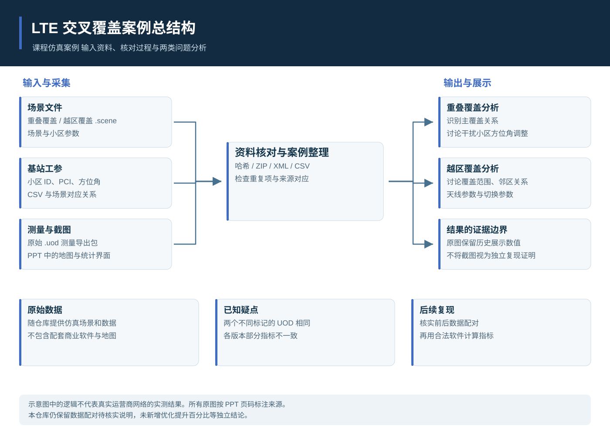

## 重叠覆盖 原 PPT 标记前

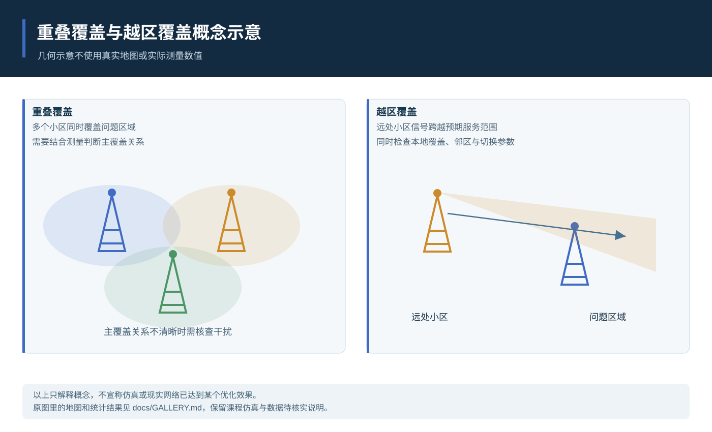

<table>
<tr>
<td width="50%" align="center" valign="top"><a href="images/gallery/lte-05.gif">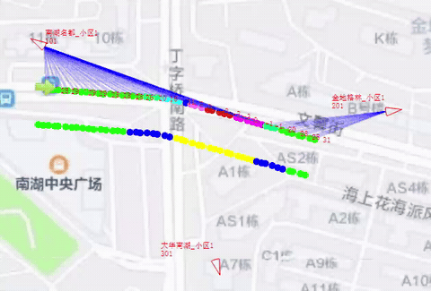</a> <strong>重叠覆盖原采集动画</strong> PPT 第 6 页标注的数据采集画面，保留原 GIF。 PPT 第 6 页</td>
<td width="50%" align="center" valign="top"><a href="images/gallery/lte-06.png">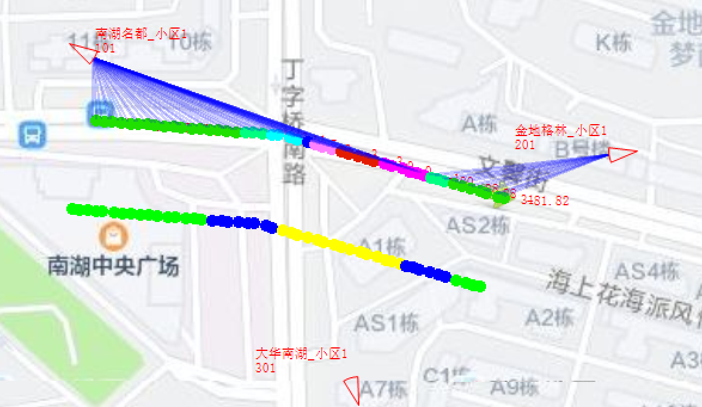</a> <strong>重叠覆盖分析地图</strong> PPT 第 7 页的问题区域与小区覆盖截图。 PPT 第 7 页</td>
</tr>
</table>

<table>
<tr>
<td width="50%" align="center" valign="top"><a href="images/gallery/lte-07.png">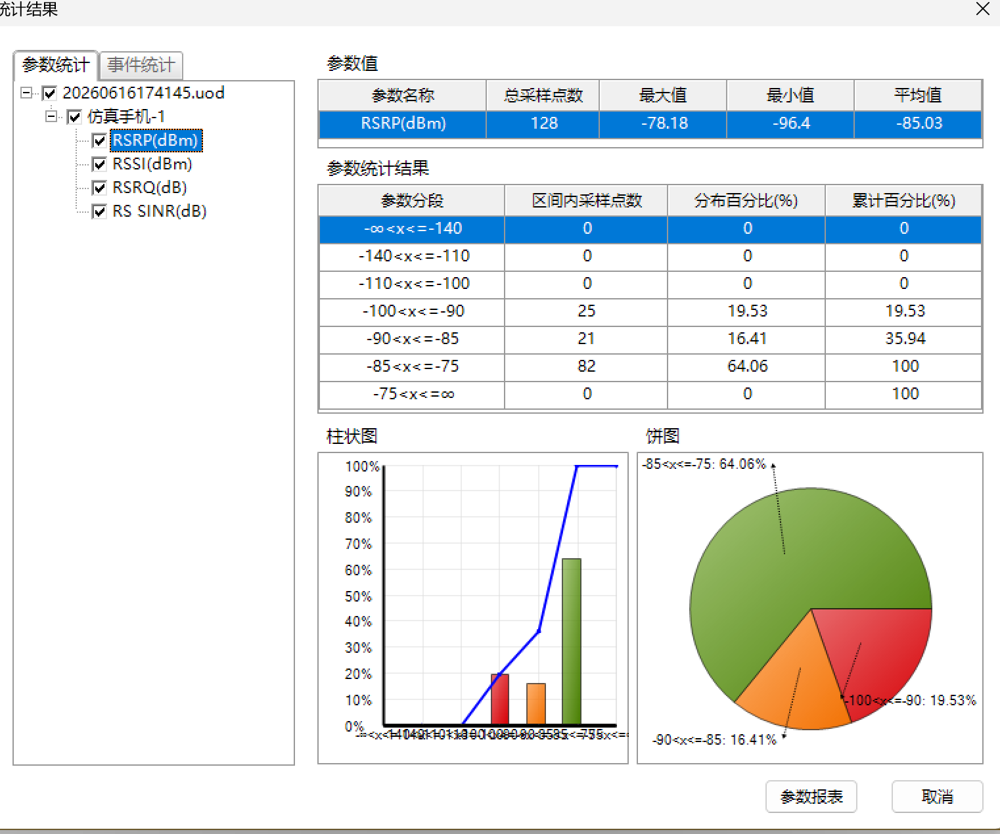</a> <strong>重叠覆盖原标记前 RSRP 统计</strong> PPT 第 7 页的统计截图；数值来源于原演示文稿，未在本次独立计算。 PPT 第 7 页</td>
<td width="50%" align="center" valign="top"><a href="images/gallery/lte-08.png">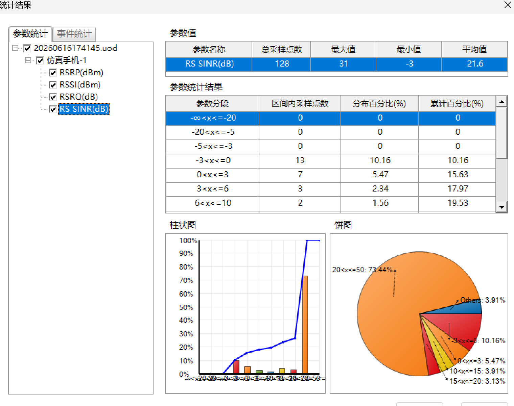</a> <strong>重叠覆盖原标记前 SINR 统计</strong> PPT 第 7 页的统计截图；保留历史显示内容。 PPT 第 7 页</td>
</tr>
</table>

## 重叠覆盖 原 PPT 标记后

<table>
<tr>
<td width="50%" align="center" valign="top"><a href="images/gallery/lte-09.gif">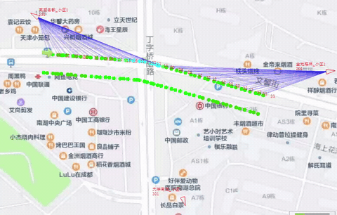</a> <strong>重叠覆盖原标记后采集动画</strong> PPT 第 8 页标注为优化操作后的采集画面。 PPT 第 8 页</td>
<td width="50%" align="center" valign="top"><a href="images/gallery/lte-10.jpeg">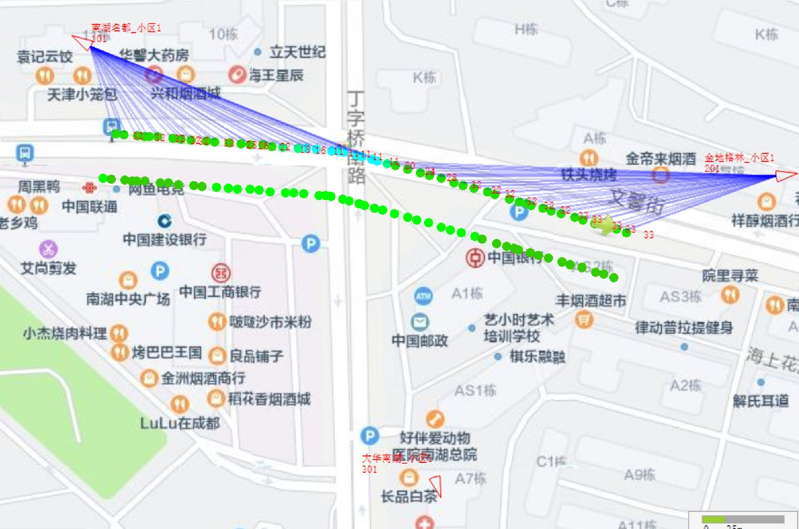</a> <strong>重叠覆盖原标记后地图</strong> PPT 第 9 页的地图截图，按原资料的前后标签展示。 PPT 第 9 页</td>
</tr>
</table>

<table>
<tr>
<td width="50%" align="center" valign="top"><a href="images/gallery/lte-11.png">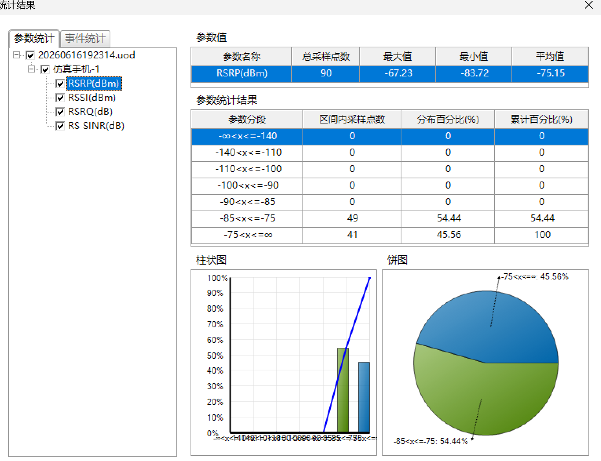</a> <strong>重叠覆盖原标记后 RSRP 统计</strong> PPT 第 9 页的统计截图，不视为本仓库独立复现的改善证据。 PPT 第 9 页</td>
<td width="50%" align="center" valign="top"><a href="images/gallery/lte-12.png">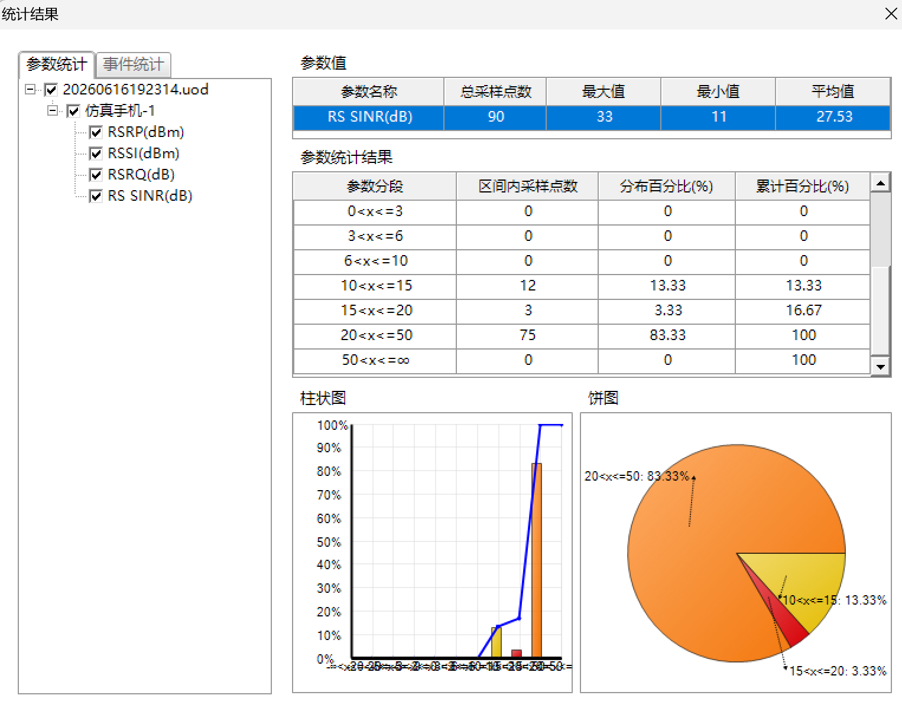</a> <strong>重叠覆盖原标记后 SINR 统计</strong> PPT 第 9 页的统计截图；前后文件配对及指标仍需核实。 PPT 第 9 页</td>
</tr>
</table>

## 越区覆盖 原 PPT 标记前

<table>
<tr>
<td width="50%" align="center" valign="top"><a href="images/gallery/lte-13.gif">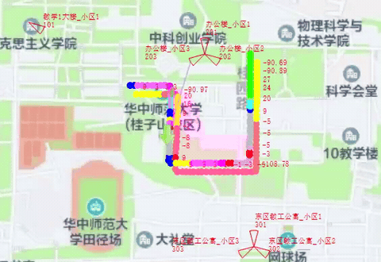</a> <strong>越区覆盖原采集动画</strong> PPT 第 12 页标注的数据采集画面，保留原 GIF。 PPT 第 12 页</td>
<td width="50%" align="center" valign="top"><a href="images/gallery/lte-14.jpeg">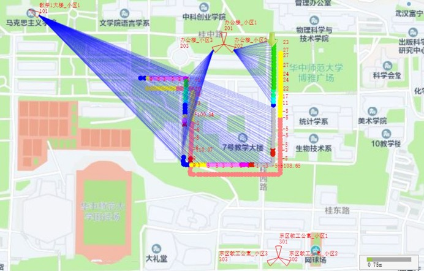</a> <strong>越区覆盖分析地图</strong> PPT 第 13 页的远处与本地小区覆盖截图。 PPT 第 13 页</td>
</tr>
</table>

<table>
<tr>
<td width="50%" align="center" valign="top"><a href="images/gallery/lte-15.png">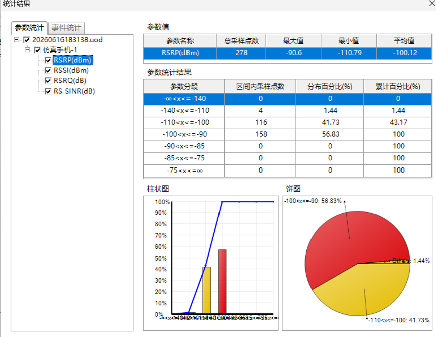</a> <strong>越区覆盖原标记前 RSRP 统计</strong> PPT 第 13 页的统计界面；不据此认定当前 UOD 已经正确配对。 PPT 第 13 页</td>
<td width="50%" align="center" valign="top"><a href="images/gallery/lte-16.png">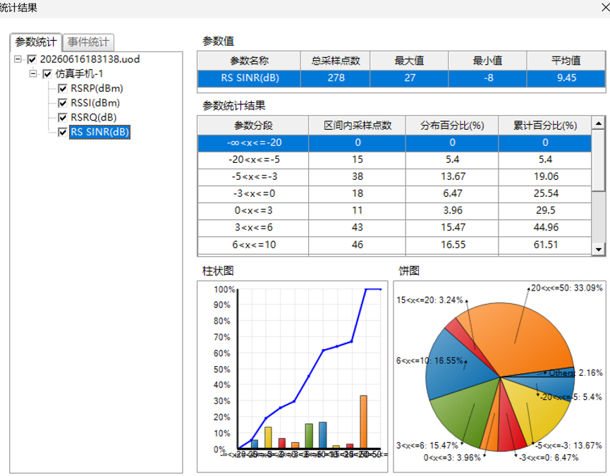</a> <strong>越区覆盖原标记前 SINR 统计</strong> PPT 第 13 页的原始统计截图，未独立重算。 PPT 第 13 页</td>
</tr>
</table>

## 越区覆盖 原 PPT 标记后

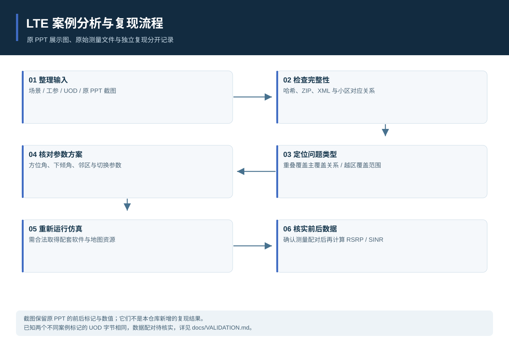

<table>
<tr>
<td width="50%" align="center" valign="top"><a href="images/gallery/lte-17.gif">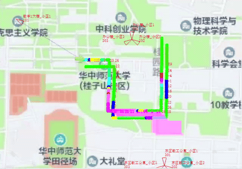</a> <strong>越区覆盖原标记后采集动画</strong> PPT 第 14 页标注为优化操作后的采集画面。 PPT 第 14 页</td>
<td width="50%" align="center" valign="top"><a href="images/gallery/lte-18.png">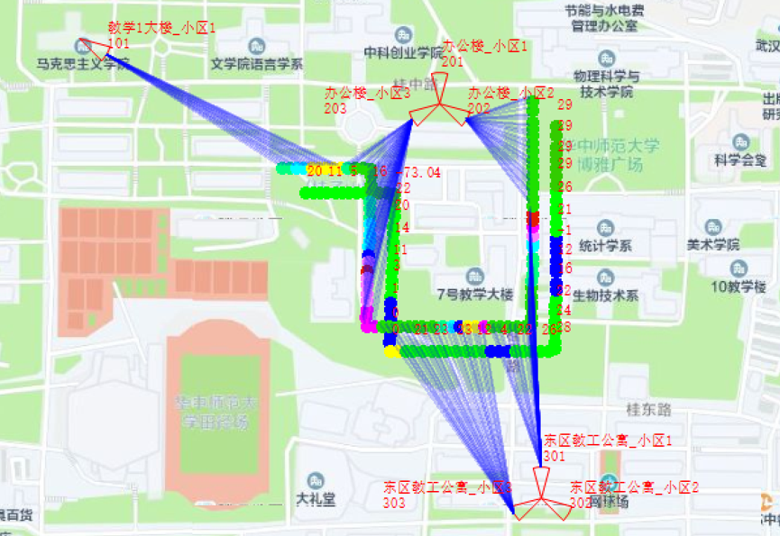</a> <strong>越区覆盖原标记后地图</strong> PPT 第 15 页的覆盖截图，属于课程仿真展示。 PPT 第 15 页</td>
</tr>
</table>

<table>
<tr>
<td width="50%" align="center" valign="top"><a href="images/gallery/lte-19.png">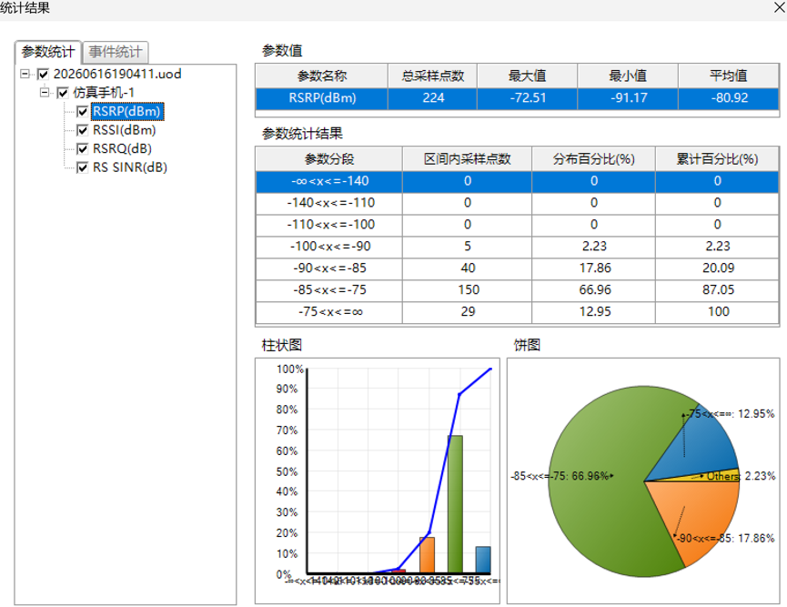</a> <strong>越区覆盖原标记后 RSRP 统计</strong> PPT 第 15 页的统计截图，原数值不代表新增的复现结论。 PPT 第 15 页</td>
<td width="50%" align="center" valign="top"><a href="images/gallery/lte-20.png">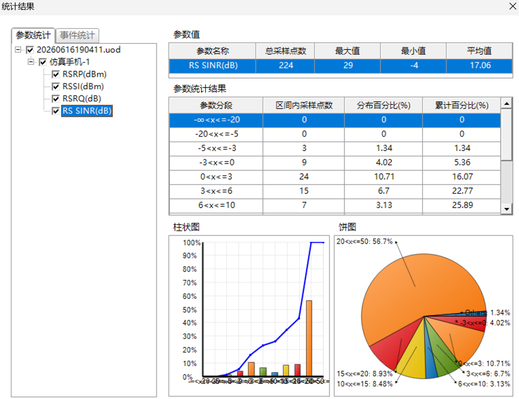</a> <strong>越区覆盖原标记后 SINR 统计</strong> PPT 第 15 页的统计截图；已知资料疑点见 VALIDATION.md。 PPT 第 15 页</td>
</tr>
</table>

## 阅读与验证边界

点击图片可查看完整大小。原文档未整体上传，标题页、姓名、学号、指导教师信息与文档元数据未纳入图集。结构图依据公开源码和现有资料绘制，表示功能关系，不能替代电气设计与实物验收。

数据配对与指标疑点继续保留在[核对记录](VALIDATION.md)中，不因补充截图而视为解决。
